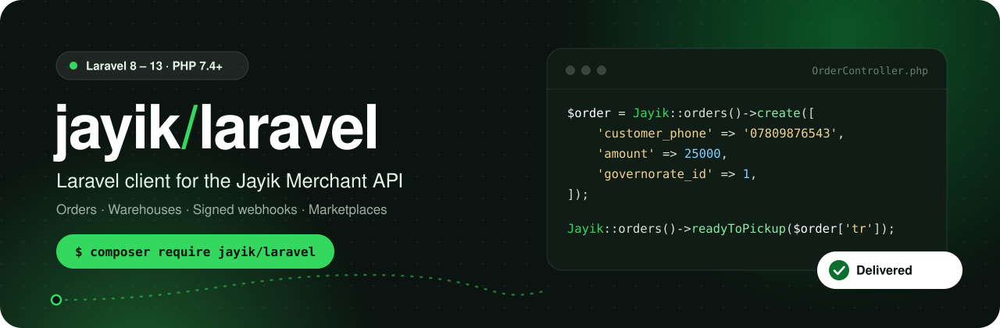
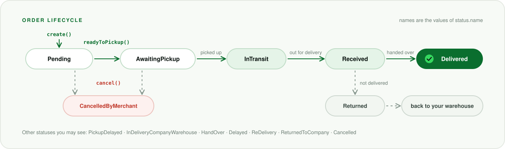
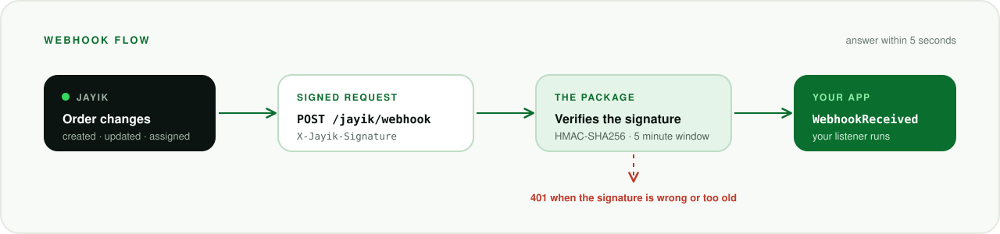

<p align="center">
  
</p>

# jayik/laravel

Laravel client for the [Jayik Merchant API v2](https://www.jayik.app/api-docs): create and track delivery orders, manage warehouses and categories, and receive signed webhooks.

- Laravel 8 – 13, PHP 7.4+
- Every endpoint of the Merchant API (39) is covered
- Unofficial package; not maintained by Jayik

## Contents

- [Installation](#installation)
- [Configuration](#configuration)
- [Quick start](#quick-start)
- [How responses work](#how-responses-work)
- [Orders](#orders)
- [Warehouses](#warehouses)
- [Order categories](#order-categories)
- [Reference data](#reference-data)
- [Account](#account)
- [API keys](#api-keys)
- [Marketplaces](#marketplaces)
- [Webhooks](#webhooks)
- [Error handling](#error-handling)
- [Rate limits](#rate-limits)
- [Constants](#constants)
- [Testing your app](#testing-your-app)
- [Method reference](#method-reference)

## Installation

```bash
composer require jayik/laravel
```

## Configuration

Create an API key in the Tajr dashboard (https://tajr.jayik.app/api-keys) and add it to `.env`. A key acts as the merchant account that owns it, so keep it on the server.

```dotenv
JAYIK_API_KEY=jk_live_...
JAYIK_WEBHOOK_SECRET=whsec_...
```

| Variable | Default | Purpose |
|---|---|---|
| `JAYIK_API_KEY` | – | Sent as the `X-API-KEY` header |
| `JAYIK_BASE_URL` | `https://api.jayik.app/api/merchant` | API root |
| `JAYIK_TIMEOUT` | `30` | Request timeout, seconds |
| `JAYIK_CONNECT_TIMEOUT` | `10` | Connection timeout, seconds |
| `JAYIK_RATE_LIMIT_RETRIES` | `2` | Retries after a 429 (`0` disables) |
| `JAYIK_RATE_LIMIT_MAX_WAIT` | `30` | Longest wait per retry, seconds |
| `JAYIK_WEBHOOK_SECRET` | – | Secret used to verify incoming webhooks |
| `JAYIK_WEBHOOK_TOLERANCE` | `300` | Maximum webhook age, seconds (`0` disables) |
| `JAYIK_WEBHOOK_ROUTE_ENABLED` | `true` | Register the package's webhook route |
| `JAYIK_WEBHOOK_PATH` | `jayik/webhook` | Path of that route |

To edit the config file (for example the webhook route's middleware), publish it:

```bash
php artisan vendor:publish --tag=jayik-config
```

## Quick start

```php
use Jayik\Laravel\Facades\Jayik;

// 1. Create the order (it starts as Pending)
$order = Jayik::orders()->create([
    'customer_name'     => 'Ali Hassan',
    'customer_phone'    => '07809876543',
    'customer_address'  => 'Baghdad, Karrada, near the bridge',
    'amount'            => 25000,          // IQD; 0 when already paid
    'governorate_id'    => 1,              // UUID or governorate number
    'order_category_id' => $categoryId,
]);

// 2. Tell Jayik it is ready for the driver
Jayik::orders()->readyToPickup($order['tr']);

// 3. Later: look it up by tracking number
$order = Jayik::orders()->findByTr($order['tr'], ['status']);
echo $order['status']['name']; // "AwaitingPickup"
```

You can also inject the class instead of using the facade:

```php
public function store(\Jayik\Laravel\Jayik $jayik) { $jayik->orders()->create([...]); }
```

## How responses work

- Methods return **plain arrays** exactly as the API sends them. The `{status, message, data}` wrapper is removed, so you get `data` directly.
- List methods return a `PaginatedResponse`:

  ```php
  $page = Jayik::orders()->list(['take' => 50]);

  $page->items();        // array of orders
  $page->collect();      // Illuminate Collection
  $page->total();        // int, or null when requested with simple => true
  $page->currentPage();
  $page->perPage();
  $page->lastPage();
  $page->hasMorePages();
  $page->toArray();      // raw page object

  foreach ($page as $order) { ... }
  ```

- `lazy()` methods return a `LazyCollection` that fetches page after page as you iterate.
- Amounts are Iraqi dinars. `take` is capped at 500 by the API.
- Failed calls throw exceptions; see [Error handling](#error-handling).

## Orders

<p align="center">
  
</p>

### Create an order

```php
$order = Jayik::orders()->create([...]);
```

| Field | Type | Required | Notes |
|---|---|---|---|
| `customer_phone` | string | yes | e.g. `07809876543` |
| `customer_address` | string | yes | |
| `amount` | number | yes | IQD to collect; `0` for prepaid |
| `order_category_id` | uuid | yes | One of your categories |
| `governorate_id` | uuid \| int | yes | Governorate UUID or its `number` |
| `customer_name` | string | no | |
| `tr` | string | no | Your own tracking number; generated when omitted |
| `warehouse_id` | uuid | no | Pickup point; must be yours |
| `district_id` | uuid | no | Needed for fawri when the account has a fawri price list |
| `delivery_type` | int | no | `0` normal (default), `1` fawri / express |
| `notes` | string | no | |
| `business_name` | string | no | |
| `destination_coordinate` | string | no | `"lat,lng"`, e.g. `"33.312805,44.361488"` |
| `total_products` | int | no | |
| `scheduled_delivery_date_from` | datetime | no | `DateTime`/Carbon objects are formatted for you |
| `scheduled_delivery_date_to` | datetime | no | Must be after `_from` |
| `invoice_url` | string | no | |
| `order_items` | array | no | Each: `attribute_id`, `name`, `weight`, `unit`, `count` |

```php
use Jayik\Laravel\Support\DeliveryType;

Jayik::orders()->create([
    'customer_phone'    => '07809876543',
    'customer_address'  => 'Erbil, 100m Street',
    'amount'            => 0,
    'governorate_id'    => $governorateUuid,
    'order_category_id' => $categoryId,
    'delivery_type'     => DeliveryType::FAWRI,
    'district_id'       => $districtId,
    'order_items'       => [
        ['attribute_id' => $attributeId, 'name' => 'T-shirt', 'weight' => 1, 'unit' => 'kg', 'count' => 2],
    ],
]);
```

### Create many orders

1 to 300 orders in one request. All are created or none are. The API returns no order data, so look them up by `tr` afterwards.

```php
Jayik::orders()->createBatch([
    ['tr' => 'A-1001', 'customer_name' => 'Ali',  'customer_phone' => '0780...', 'customer_address' => '...', 'amount' => 15000, 'order_category_id' => $cat, 'governorate_id' => $govUuid],
    ['tr' => 'A-1002', 'customer_name' => 'Sara', 'customer_phone' => '0770...', 'customer_address' => '...', 'amount' => 9000,  'order_category_id' => $cat, 'governorate_id' => $govUuid],
]);
```

Differences from single create: `tr` and `customer_name` are **required**, and `governorate_id` must be the **UUID** (the number is not accepted).

### List and search

```php
$page = Jayik::orders()->list([
    'take'    => 50,                    // default 15
    'page'    => 1,
    'sort'    => '-created_at',         // "-" = descending
    'from'    => '2026-11-01',          // last-update range; send both
    'to'      => '2026-11-30',
    'simple'  => true,                  // skip the total count (faster)
    'include' => ['status', 'customer', 'warehouse'],
    'filter'  => [
        'status_id'      => [$pendingId, $awaitingId],  // arrays become CSV
        'warehouse_id'   => $warehouseId,
        'customer.phone' => '07809876543',
    ],
]);
```

| Filter | Matches |
|---|---|
| `tr`, `uuid` | Exact order |
| `status_id`, `not_status_id` | One or more status ids |
| `governorate_id`, `warehouse_id`, `order_category_id` | By relation |
| `delivery_type` | `0` or `1` |
| `customer.phone` | Phone |
| `customer.name`, `customer.address` | Search |
| `amount` | Amount |

Allowed `include` values: `status`, `customer`, `governorate`, `district`, `warehouse`, `orderCategory`, `orderItems`, `orderItems.attribute`, `merchant`, `history.merchant`, `driverRate`, `amountChanges`, `financial`. Nested objects only appear when included.

Walk through every match without handling pages yourself:

```php
Jayik::orders()->lazy(['filter' => ['warehouse_id' => $id]])
    ->each(fn ($order) => SyncOrder::dispatch($order));
```

### Get one order

```php
Jayik::orders()->get(123, ['status', 'history.merchant']); // by numeric id
Jayik::orders()->findByTr('100006537', ['status']);         // by tracking number, null if none
```

An order has three identifiers: `tr` (tracking number, used by most actions), `id` (integer, used by `get` and `delete`) and `uuid`.

### Change an order

```php
Jayik::orders()->readyToPickup($tr); // Pending -> AwaitingPickup
Jayik::orders()->cancel($tr);        // while Pending, AwaitingPickup or PickupDelayed
Jayik::orders()->delete($id);        // permanent; only while Pending
```

### Tracking numbers

```php
$tr = Jayik::orders()->generateTr();  // "100006537"
Jayik::orders()->trExists('A-1001');  // bool
```

## Warehouses

Warehouses are your pickup points. Pass a warehouse's `id` as `warehouse_id` when creating an order.

```php
$warehouse = Jayik::warehouses()->create([
    'name'                    => 'Main store',     // required
    'address'                 => 'Baghdad, Mansour', // required
    'governorate_id'          => 1,                // UUID or number
    'lat'                     => 33.3128,
    'long'                    => 44.3615,
    'phone'                   => '07801234567',
    'secondary_phone'         => null,
    'availability_times_from' => '09:00',
    'availability_times_to'   => '18:00',
    'site_id'                 => 'vendor-42',      // your own reference
]);

Jayik::warehouses()->list($take = 15, $page = 1);
Jayik::warehouses()->lazy();
Jayik::warehouses()->get($id);
Jayik::warehouses()->update($id, ['name' => 'New name', 'governorate_id' => 1]);
Jayik::warehouses()->delete($id);
Jayik::warehouses()->setDefault($id); // used when an order has no warehouse_id
```

> Always send `governorate_id` when updating. Leaving it out clears the warehouse's governorate.

### Business hours

```php
Jayik::warehouses()->businessHours($id);
// [['day' => 'sunday', 'opens_at' => '09:00', 'closes_at' => '17:00', 'is_closed' => false], ...]

Jayik::warehouses()->updateBusinessHours($id, [
    'sunday' => ['is_closed' => false, 'opens_at' => '09:00', 'closes_at' => '17:00'],
    'friday' => ['is_closed' => true],
]); // days you leave out stay as they are
```

## Order categories

Every order needs one of your categories.

```php
$category = Jayik::orderCategories()->create('Clothes');

Jayik::orderCategories()->list($take = 10, $page = 1);
Jayik::orderCategories()->lazy();
Jayik::orderCategories()->get($id);
Jayik::orderCategories()->update($id, 'Fashion');
Jayik::orderCategories()->delete($id);
Jayik::orderCategories()->setDefault($id);
```

## Reference data

These rarely change, so cache them.

```php
$governorates = Cache::remember('jayik.governorates', now()->addDay(), fn () => Jayik::governorates()->all());
// [['id' => '...', 'name' => 'بغداد', 'number' => 1], ...]

Jayik::statuses()->all();     // id, name (stable code), ar_name, en_name, kr_name, color, ...
Jayik::attributes()->all();   // product types for order_items[].attribute_id

// Paged and single lookups
Jayik::governorates()->list($take = 10, $page = 1);
Jayik::governorates()->get($id);
Jayik::statuses()->list();
Jayik::statuses()->get($id);
Jayik::attributes()->list();
```

Status ids are UUIDs. To filter orders by status, map the stable `name` to its id once:

```php
use Jayik\Laravel\Support\OrderStatus;

$statusIds = collect(Jayik::statuses()->all())->pluck('id', 'name');

Jayik::orders()->list(['filter' => ['status_id' => $statusIds[OrderStatus::DELIVERED]]]);
```

## Account

```php
$details = Jayik::account()->details();
// ['user' => [...], 'roles' => [...], 'permissions' => [...]]

Jayik::account()->permissions(); // ['merchant-get-order', 'merchant-store-order', ...]
```

Keys that belong to an employee only have that employee's permissions; a missing permission results in a `PermissionDeniedException`.

## API keys

```php
$key = Jayik::apiKeys()->create('Production server');
$key['key']; // shown only this once — store it now

Jayik::apiKeys()->list();
Jayik::apiKeys()->get($id);                         // never includes the value
Jayik::apiKeys()->update($id, $active = false);     // switch off
Jayik::apiKeys()->update($id, true, 'New label');
Jayik::apiKeys()->regenerate($id);                  // old value stops working immediately
Jayik::apiKeys()->delete($id);
```

## Marketplaces

**One Jayik account, many vendors.** Create a warehouse per vendor and keep its id:

```php
$warehouse = Jayik::warehouses()->create([
    'name'    => $vendor->name,
    'address' => $vendor->address,
    'site_id' => (string) $vendor->id,
]);

$vendor->update(['jayik_warehouse_id' => $warehouse['id']]);
```

An order has one pickup point, so a basket with products from several vendors becomes one order per vendor:

```php
foreach ($cart->items->groupBy('vendor_id') as $vendorId => $items) {
    Jayik::orders()->create([
        'warehouse_id'     => $vendors[$vendorId]->jayik_warehouse_id,
        'amount'           => $items->sum('total'),
        'total_products'   => $items->sum('quantity'),
        // customer and destination fields...
    ]);
}
```

Then list a vendor's orders with `'filter' => ['warehouse_id' => $id]`.

**Each vendor has their own Jayik account.** Switch keys per call; the default key is untouched:

```php
Jayik::withKey($vendor->jayik_api_key)->orders()->create([...]);
```

## Webhooks

<p align="center">
  
</p>

Jayik sends a `POST` to your URL whenever one of your orders is created or changes. The package registers the route, verifies the signature and dispatches a Laravel event.

### 1. Register your URL

```php
Jayik::webhook()->set('https://your-app.com/jayik/webhook'); // must be https
Jayik::webhook()->secret(); // "whsec_..." -> put it in JAYIK_WEBHOOK_SECRET
```

### 2. Listen

```php
use Illuminate\Support\Facades\Event;
use Jayik\Laravel\Support\OrderStatus;
use Jayik\Laravel\Webhooks\WebhookReceived;

Event::listen(function (WebhookReceived $event) {
    $webhook = $event->webhook;

    if ($webhook->status() === OrderStatus::DELIVERED) {
        Order::where('tracking_number', $webhook->tr())->update(['delivered_at' => now()]);
    }
});
```

| On `$event->webhook` | |
|---|---|
| `->operation` | `created`, `updated`, `assigned`, `deleted`, `restored`, `forceDeleted` |
| `->order` | The order record as an array (includes `driver`) |
| `->payload` | The full decoded body |
| `->tr()` | Tracking number |
| `->status()` | Status code, e.g. `Delivered` |
| `->driver()` | `id`, `name`, `phone` (null unless enabled for your account) |
| `->isCreated()`, `->isUpdated()`, `->isAssigned()`, `->isDeleted()` | Shortcuts |

Jayik expects a 2xx answer within 5 seconds. Make slow listeners queued (`implements ShouldQueue`).

### 3. Test it

```php
Jayik::webhook()->test();                    // sample data, operation "created"
Jayik::webhook()->test($tr, 'updated');      // a real order's data
Jayik::webhook()->redeliver($tr);            // re-send "created" for an order
Jayik::webhook()->get();                     // current URL, secret and signature scheme
Jayik::webhook()->remove();                  // stop receiving events
```

### How verification works

Each request carries `X-Jayik-Timestamp` (Unix seconds) and `X-Jayik-Signature` (`sha256=` + hex digest). The signature is HMAC-SHA256 of `{timestamp}.{raw body}` with your webhook secret. Requests with a wrong signature, missing headers, or a timestamp older than the tolerance get a `401`, and no event is dispatched.

### Using your own route

Turn the built-in route off and protect your own with the `jayik.webhook` middleware:

```dotenv
JAYIK_WEBHOOK_ROUTE_ENABLED=false
```

```php
use Jayik\Laravel\Webhooks\WebhookEvent;

Route::post('/hooks/jayik', function (Request $request) {
    $webhook = WebhookEvent::fromRequest($request);
    // ...
    return response()->noContent();
})->middleware('jayik.webhook');
```

Keep this route out of CSRF protection (routes in `routes/api.php` already are).

Or verify by hand anywhere:

```php
use Jayik\Laravel\Webhooks\SignatureVerifier;

$valid = app(SignatureVerifier::class)->isValid(
    $request->getContent(),
    $request->header('X-Jayik-Signature'),
    $request->header('X-Jayik-Timestamp')
);
```

## Error handling

Every failed call throws a subclass of `Jayik\Laravel\Exceptions\RequestException`, which itself extends `JayikException`.

| Status | Exception | Meaning |
|---|---|---|
| 400 | `ValidationException` | Invalid or refused input |
| 401 | `AuthenticationException` | Missing or invalid key |
| 403 | `PermissionDeniedException` | Inactive account, missing permission, or action not allowed |
| 404 | `NotFoundException` | Nothing with that id on your account |
| 409 | `ConflictException` | Not possible in the order's current state |
| 422 | `UnprocessableException` | Valid request that cannot be carried out |
| 429 | `RateLimitException` | Too many requests |
| other | `RequestException` | Anything else, e.g. 5xx |

```php
use Jayik\Laravel\Exceptions\RequestException;
use Jayik\Laravel\Exceptions\ValidationException;

try {
    Jayik::orders()->create($data);
} catch (ValidationException $e) {
    $e->errors();     // ['customer_phone' => ['The customer phone field is required.']]
    $e->getMessage(); // first message
} catch (RequestException $e) {
    $e->status();     // HTTP status
    $e->response;     // Illuminate\Http\Client\Response
}
```

A missing API key throws a `JayikException` before any request is sent. Network failures surface as Laravel's own `Illuminate\Http\Client\ConnectionException`.

## Rate limits

The API allows 120 requests per minute per account. When it answers `429`, the client waits the number of seconds in `Retry-After` and tries again, up to `JAYIK_RATE_LIMIT_RETRIES` times. If the wait would be longer than `JAYIK_RATE_LIMIT_MAX_WAIT`, or retries run out, you get a `RateLimitException`:

```php
catch (RateLimitException $e) {
    $job->release($e->retryAfter() ?? 60);
}
```

For bulk work, prefer `createBatch()` and a larger `take` over many small calls.

## Constants

```php
use Jayik\Laravel\Support\DeliveryType;     // NORMAL (0), FAWRI (1)
use Jayik\Laravel\Support\OrderStatus;
use Jayik\Laravel\Support\WebhookOperation; // CREATED, UPDATED, ASSIGNED, DELETED, RESTORED, FORCE_DELETED
```

| `OrderStatus` | Value | Meaning |
|---|---|---|
| `PENDING` | `Pending` | Created, waiting for you to mark it ready |
| `AWAITING_PICKUP` | `AwaitingPickup` | Ready for the driver |
| `PICKUP_DELAYED` | `PickupDelayed` | |
| `CANCELLED_BY_MERCHANT` | `CancelledByMerchant` | |
| `IN_TRANSIT` | `InTransit` | |
| `IN_DELIVERY_COMPANY_WAREHOUSE` | `InDeliveryCompanyWarehouse` | |
| `RECEIVED` | `Received` | With the driver, out for delivery |
| `HAND_OVER` | `HandOver` | |
| `DELAYED` | `Delayed` | |
| `RE_DELIVERY` | `ReDelivery` | |
| `DELIVERED` | `Delivered` | |
| `RETURNED` | `Returned` | |
| `RETURNED_TO_COMPANY` | `ReturnedToCompany` | |
| `ON_THE_WAY_TO_MERCHANT_WAREHOUSE` | `OnTheWayToMerchantWarehouse` | |
| `RETURNED_TO_MAIN_WAREHOUSE` | `ReturnedToMainWarehouse` | |
| `CANCELLED` | `Cancelled` | |

`OrderStatus::CANCELLABLE` lists the statuses in which `cancel()` is allowed.

## Testing your app

The package uses Laravel's HTTP client, so `Http::fake()` works as usual:

```php
use Illuminate\Support\Facades\Http;

Http::fake([
    'api.jayik.app/*' => Http::response([
        'status' => true, 'message' => 'Order Created Successfully',
        'data'   => ['id' => 1, 'tr' => '100006537'],
    ]),
]);

$this->post('/checkout', [...])->assertOk();

Http::assertSent(fn ($request) => $request->url() === 'https://api.jayik.app/api/merchant/v2/orders'
    && $request['amount'] === 25000);
```

To fake an incoming webhook in a feature test, sign it with the verifier:

```php
$body = json_encode(['opration' => 'updated', 'data' => ['tr' => '100', 'status' => ['name' => 'Delivered']]]);
$time = time();

$this->call('POST', '/jayik/webhook', [], [], [], [
    'CONTENT_TYPE'           => 'application/json',
    'HTTP_X_JAYIK_TIMESTAMP' => (string) $time,
    'HTTP_X_JAYIK_SIGNATURE' => app(\Jayik\Laravel\Webhooks\SignatureVerifier::class)->sign($body, $time),
], $body)->assertOk();
```

Run the package's own tests with `composer test`.

## Method reference

| Call | Endpoint | Permission |
|---|---|---|
| `account()->details()` | `GET /auth/details` | – |
| `orders()->list($query)` / `lazy($query)` | `GET /v2/orders` | `merchant-get-order` |
| `orders()->get($id, $include)` | `GET /v2/orders/{id}` | `merchant-show-order` |
| `orders()->findByTr($tr, $include)` | `GET /v2/orders?filter[tr]=` | `merchant-get-order` |
| `orders()->create($order)` | `POST /v2/orders` | `merchant-store-order` |
| `orders()->createBatch($orders)` | `POST /v2/orders/batch` | `merchant-store-order` |
| `orders()->generateTr()` | `GET /v2/orders/generate-tr` | – |
| `orders()->trExists($tr)` | `GET /v2/orders/tr-exists/{tr}` | – |
| `orders()->cancel($tr)` | `PUT /v2/orders/cancel` | `merchant-cancel-order` |
| `orders()->readyToPickup($tr)` | `PUT /v2/orders/ready-to-pickup` | `merchant-update-order` |
| `orders()->delete($id)` | `DELETE /v2/orders/{id}` | `merchant-delete-order` |
| `warehouses()->list()` / `lazy()` | `GET /v2/warehouses` | `merchant-get-warehouse` |
| `warehouses()->get($id)` | `GET /v2/warehouses/{id}` | `merchant-show-warehouse` |
| `warehouses()->create($data)` | `POST /v2/warehouses` | `merchant-store-warehouse` |
| `warehouses()->update($id, $data)` | `PUT /v2/warehouses/{id}` | `merchant-update-warehouse` |
| `warehouses()->delete($id)` | `DELETE /v2/warehouses/{id}` | `merchant-delete-warehouse` |
| `warehouses()->setDefault($id)` | `PUT /v2/warehouses/default` | `merchant-update-DefaultWarehouse` |
| `warehouses()->businessHours($id)` | `GET /v2/warehouses/{id}/business-hours` | – |
| `warehouses()->updateBusinessHours($id, $hours)` | `PUT /v2/warehouses/{id}/business-hours` | `merchant-update-warehouse` |
| `orderCategories()->list()` / `lazy()` | `GET /v2/order-categories` | `merchant-get-orderCategory` |
| `orderCategories()->get($id)` | `GET /v2/order-categories/{id}` | `merchant-show-orderCategory` |
| `orderCategories()->create($name)` | `POST /v2/order-categories` | `merchant-store-orderCategory` |
| `orderCategories()->update($id, $name)` | `PUT /v2/order-categories/{id}` | `merchant-update-orderCategory` |
| `orderCategories()->delete($id)` | `DELETE /v2/order-categories/{id}` | `merchant-delete-orderCategory` |
| `orderCategories()->setDefault($id)` | `PUT /v2/order-categories/default` | `merchant-update-DefaultCategory` |
| `governorates()->list()` / `all()` | `GET /v2/governorates` | – |
| `governorates()->get($id)` | `GET /v2/governorates/{id}` | – |
| `statuses()->list()` / `all()` | `GET /v2/statuses` | – |
| `statuses()->get($id)` | `GET /v2/statuses/{id}` | – |
| `attributes()->list()` / `all()` | `GET /v2/attributes` | – |
| `webhook()->get()` / `secret()` | `GET /v2/webhook` | `merchant-get-webhook` |
| `webhook()->set($url)` / `remove()` | `PUT /v2/webhook` | `merchant-store-webhook` |
| `webhook()->test($tr, $operation)` | `POST /v2/webhook/test` | `merchant-send-webhook` |
| `webhook()->redeliver($tr)` | `POST /v2/webhook/deliveries/{tr}` | `merchant-send-webhook` |
| `apiKeys()->list()` | `GET /v2/api-keys` | `merchant-get-apiKey` |
| `apiKeys()->get($id)` | `GET /v2/api-keys/{id}` | `merchant-show-apiKey` |
| `apiKeys()->create($description)` | `POST /v2/api-keys` | `merchant-store-apiKey` |
| `apiKeys()->regenerate($id)` | `POST /v2/api-keys/regenerate` | `merchant-re-generate-apiKey` |
| `apiKeys()->update($id, $active, $description)` | `PUT /v2/api-keys/{id}` | `merchant-update-apiKey` |
| `apiKeys()->delete($id)` | `DELETE /v2/api-keys/{id}` | `merchant-delete-apiKey` |

For an endpoint the package does not wrap yet, use the client directly:

```php
Jayik::client()->get('v2/something', ['take' => 10]);
Jayik::client()->post('v2/something', ['field' => 'value']);
```

## License

MIT
